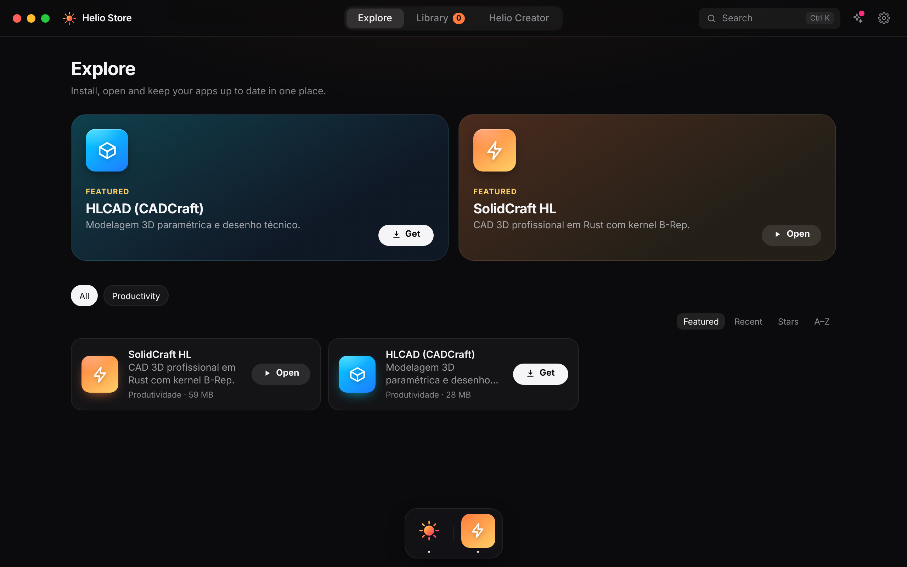
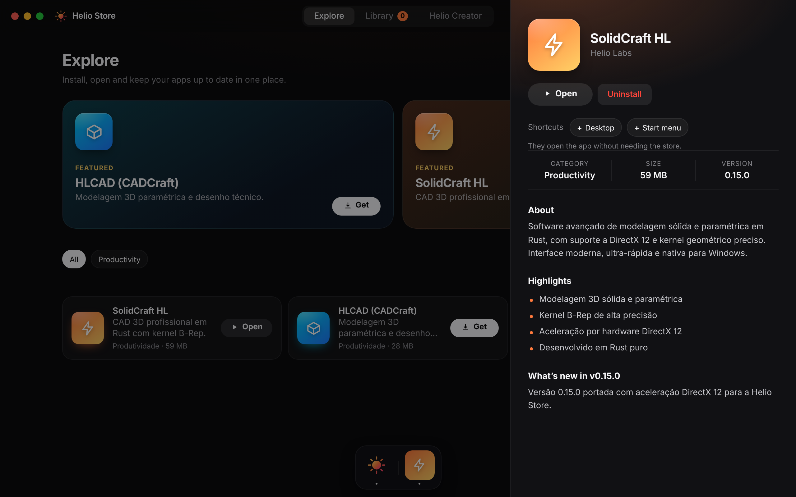
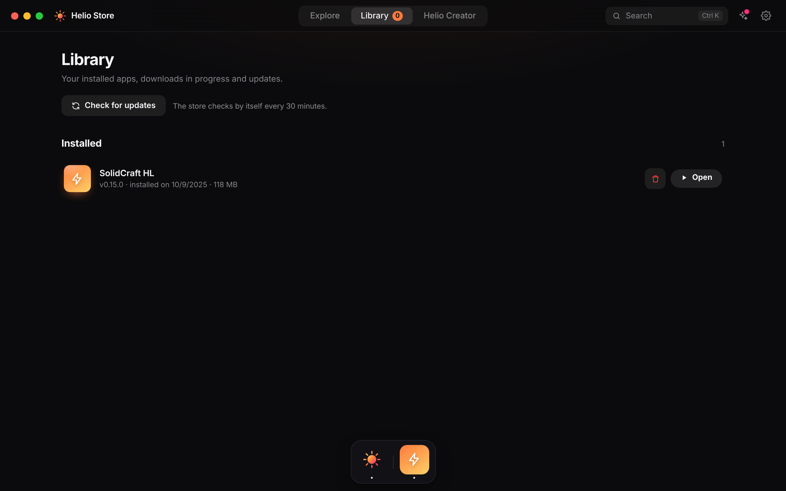

# ☀️ Helio Store





**Uma loja de apps minimalista para Windows, onde qualquer pessoa publica um app colando o link do GitHub.**

<!-- Quando tiver o GIF (15–20 s: dock, instalação e Helio Creator), salve em docs/demo.gif e troque esta linha por:  -->

## O que ela faz

- **Instala e atualiza apps sozinha.** Lê o último Release do repositório, confere o SHA-256 do arquivo e instala. Se uma atualização der problema, dá para **voltar para a versão anterior**.
- **Helio Creator.** Cole `https://github.com/usuario/meu-app` e o app entra na loja, com nome, ícone e descrição lidos do repositório (ou de um `helio.json`). Cole vários links de uma vez, se quiser.
- **Dock flutuante.** Ao minimizar, seus apps instalados ficam num dock discreto, no estilo macOS.
- **Perfil e GitHub opcionais.** Crie um perfil local sem cadastro. Se vincular o GitHub (token ou código no navegador), a loja lista seus repositórios e mostra quais têm Release.
- **Minimalista e leve.** Tema escuro e claro, atalho global `Ctrl+Alt+H`, bandeja do sistema e inicialização com o Windows.
- **Português, inglês e espanhol.**

## Baixar

Pegue o instalador mais recente em **[Releases](../../releases/latest)** e execute o `.exe`.

> O instalador ainda não tem assinatura digital, então o Windows SmartScreen pode avisar "editor desconhecido". Clique em **Mais informações → Executar assim mesmo**. O código é aberto: você pode ler tudo aqui.

## Publicar o seu app em 3 passos

1. Gere um **Release** no GitHub com um `.zip`, `.exe` ou `.msi` para Windows. A tag vira a versão.
2. Abra a aba **Helio Creator** e cole o link do repositório.
3. Pronto. A cada Release novo, quem já instalou vê **Atualizar**.

Opcional: um `helio.json` na raiz do repositório para escolher nome, ícone, categoria e o executável:

```json
{ "name": "Meu App", "tagline": "Frase curta", "category": "Utilitários", "icon": "icon.png", "exe": "MeuApp.exe" }
```

## Atalhos dos apps

Na página de cada app instalado, ligue **Área de Trabalho** ou **Menu Iniciar**. O atalho abre o app direto, sem a loja aberta, e é refeito sozinho depois de cada atualização.

## Idiomas e traduções

A loja fala **português, inglês, espanhol, francês, alemão, italiano, japonês, chinês e russo**. O instalador e a loja seguem o idioma do Windows (idioma não suportado cai para inglês) e dá para trocar em Ajustes.

- **Texto novo na interface:** escreva em português no código e adicione a frase como chave em `src/i18n.js` (inglês e espanhol) e em `src/lang/*.js` (demais idiomas). Rode `npm run i18n`: ele lista tudo que está sem tradução (`--strict` exige todos os idiomas; o GitHub roda essa checagem a cada envio).
- **Textos dos apps** (descrição, novidades): são traduzidos sozinhos para o idioma de cada pessoa, com cache. Quem publica pode controlar a tradução com um bloco `i18n` no `helio.json` (o Helio Creator gera esse bloco no botão *Traduzir para todos os idiomas*).

## English

Helio Store is a minimalist Windows app store. Publish any app by pasting its GitHub link: the store reads the latest Release, verifies the SHA-256, installs it and keeps it updated, with one-click rollback. Includes a floating macOS-style dock, a local creator profile with optional GitHub sign-in, dark/light themes and PT/EN/ES.

---

Loja desktop (Electron) para instalar os apps do ecossistema Helio.

# Para desenvolvedores

## Lançar uma versão da loja

1. Aumente `"version"` no `package.json` (ex.: `2.1.0`) e faça o commit.
2. Crie a tag e envie: `git tag v2.1.0 && git push origin v2.1.0`.
3. O GitHub Actions (`.github/workflows/release.yml`) gera `HelioStore-Setup-2.1.0.exe` e publica no Release.
4. Quem já tem a loja vê **Atualizar agora** em até 30 minutos. O repositório usado é o do campo `repository` do `package.json` (ou o que estiver em Ajustes).

## Rodar o código

```bash
npm install
npm start        # ou: npm run dev  (abre DevTools)
npm run dist     # gera instalador .exe (electron-builder)
```

## Adicionando apps pelo catálogo

Edite [`catalog/apps.json`](catalog/apps.json) **ou** hospede um `apps.json` em qualquer URL
e configure em **Configurações → Catálogo remoto** (apps remotos sobrescrevem os locais com mesmo `id`).

```jsonc
{
  "id": "meu-app",               // único
  "name": "Meu App",
  "tagline": "Frase curta",
  "description": "Texto longo…",
  "category": "Produtividade",
  "developer": "Helio Labs",
  "version": "1.0.0",            // mudar a versão mostra "Atualizar" para quem já tem
  "sizeMB": 40,
  "rating": 4.8,
  "glyph": "note",               // note|music|code|shield|image|chat|chart|game|bolt|box|globe|star
  "colors": ["#ff9a3c", "#ff3d77"],
  "icon": "https://…/icon.png",  // opcional (substitui o ícone gerado)
  "screenshots": ["https://…/1.png"], // opcional (senão gera mockups)
  "features": ["…"],
  "changelog": "…",
  "download": {
    "url": "https://github.com/voce/app/releases/download/v1.0.0/MeuApp.zip",
    "type": "zip",               // zip | exe | msi  (deduzido pela extensão)
    "exe": "MeuApp.exe",         // zip: executável dentro do zip
    "args": ["/S"],              // exe/msi: argumentos do instalador (ex.: silencioso)
    "launch": "%LOCALAPPDATA%\\Programs\\MeuApp\\MeuApp.exe", // exe/msi: o que abrir depois
    "uninstall": "%LOCALAPPDATA%\\Programs\\MeuApp\\Uninstall MeuApp.exe"
  }
}
```

- `url` aceita **http(s)**, `file://` ou caminho local (`C:\builds\MeuApp.zip`) — ótimo para testar builds.
- `url: "demo"` simula a instalação (usado pelos apps de exemplo).
- `.zip` é extraído em `%APPDATA%/helio-store/apps/<id>` (alterável nas Configurações).

## Como a publicação pelo GitHub funciona

Na aba **Publicar**, cole o link `https://github.com/usuario/meu-app`. A loja:

1. lê o **último Release** (versão = tag, arquivo = `.zip`/`.exe`/`.msi` de Windows);
2. lê o `helio.json` na raiz do repo, se existir (nome, ícone, categoria, descrição, `exe`...);
3. mostra o app em **Explorar** com a etiqueta *Comunidade*;
4. checa novas tags a cada 30 min e mostra **Atualizar** para quem já instalou.

Apps do catálogo com `"repo": "usuario/repositorio"` também se atualizam sozinhos.

### Registro público (aparecer para todo mundo)
Hospede um JSON com uma lista de links e aponte em **Ajustes → Catálogo remoto**:

```json
{ "repos": ["usuario/app-1", "outra-pessoa/app-2"] }
```

Quem quiser entrar na lista abre um Pull Request nesse arquivo; você revisa antes de aceitar.
Apps de terceiros executam código no PC do usuário, então revise antes de aprovar.
